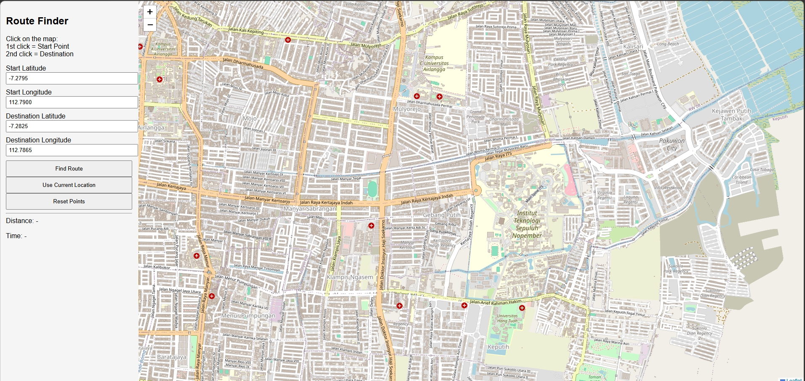
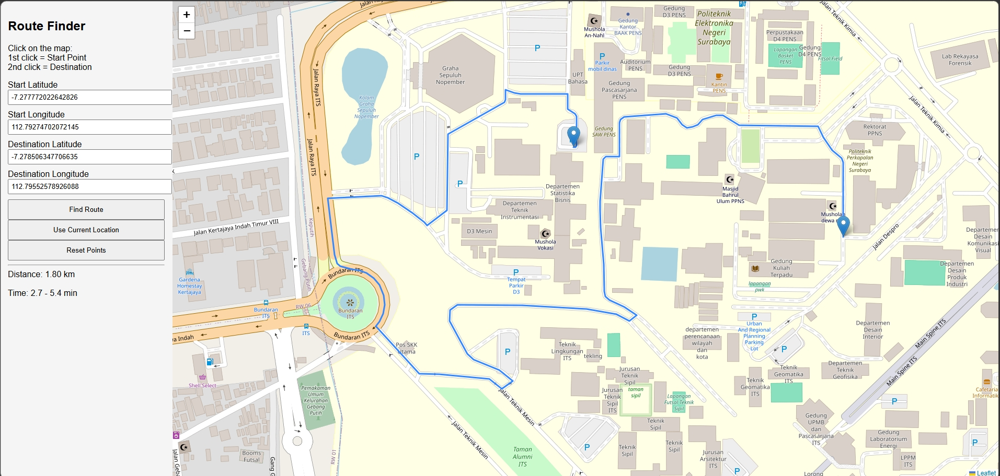

# Hybrid Route Finder for Surabaya

Hybrid Route Finder computes a shortest route by distance between two points on an OpenStreetMap road network. The Leaflet demo lets you choose points on a map around ITS, Manyar, and Kertajaya. The C++ backend snaps them to road nodes and runs A*, with Dijkstra available as a comparison baseline.

This group capstone was submitted as the final exam project for Design & Analysis of Algorithms E, Department of Informatics, Institut Teknologi Sepuluh Nopember (ITS), in the even semester of 2025/2026.

## Demo



*The initial map opens near ITS with default coordinates in the sidebar. Map data © OpenStreetMap contributors.*



*A route through the ITS campus with a distance of 1.80 km and an estimated time of 2.7–5.4 minutes. Map data © OpenStreetMap contributors.*

[OpenStreetMap copyright and license](https://www.openstreetmap.org/copyright)

## Architecture

At startup, TinyXML2 reads the local OSM XML extract. The server builds a directed road graph and a two-dimensional KD-tree, then starts the Crow HTTP server on port 8080. Standalone Asio supplies the networking.

```text
Leaflet map or coordinate fields
  -> POST /route with two coordinate pairs
  -> KD-tree lookup for each endpoint
  -> A* on the directed road graph
  -> JSON with ordered route coordinates and search metrics
  -> Leaflet polyline, snapped markers, and distance summary
```

The frontend consists of static HTML, CSS, and JavaScript. Its basemap comes from OpenStreetMap's tile service. Routing uses the local XML extract and can be called directly over HTTP without the map.

### Road graph and snapping

The parser makes three passes over the XML. It collects the node references of ways tagged `highway=*`, loads the referenced nodes, and adds directed edges between consecutive references whose nodes are both present. Each node holds a 64-bit OSM ID and latitude and longitude in decimal degrees. An ID-to-index map gives access to compact internal indices. The adjacency list at each index stores outgoing edges as destination indices and Haversine distances in meters, using a spherical Earth radius of 6,371,000 m.

A way tagged exactly `oneway=yes` contributes edges in the order of its node references. Other ways contribute edges in both directions. This simplified model includes every highway class and ignores access restrictions, turn restrictions, and other one-way tag conventions.

The KD-tree splits at medians on alternating latitude and longitude axes. It ranks candidate vertices by Haversine distance. Its branch-pruning test compares squared differences in degrees with a best distance in meters, so that test cannot guarantee an exact nearest neighbor for arbitrary inputs. Repeated median sorting costs O(V log² V) to build the tree, and a lookup can visit O(V) nodes. Snapping selects vertices, with no projection onto road segments or maximum snap distance.

### Shortest-path search

| Algorithm | Binary min-heap priority | Use |
| --- | --- | --- |
| Dijkstra | Best known distance from the start, `g(v)` | Baseline for nonnegative edge weights |
| A* | `g(v) + h(v)`, with `h(v)` the Haversine distance to the goal | Search used by the HTTP API |

For the stored Haversine edge costs, the triangle inequality gives `h(u) ≤ cost(u,v) + h(v)` on each directed edge. This makes the heuristic consistent and a lower bound on the remaining path cost. Under these costs, A* can finalize each vertex once and stop when it finalizes the goal, yielding a minimum-cost path between the snapped vertices when one exists. Both searches reconstruct the path from parent indices.

For V vertices and E directed edges, both implementations use O(V + E) space. Improved costs add new heap entries, and the search skips entries for already finalized nodes. The resulting worst-case time bound is O(V + E log(E + 1)), commonly expressed as O((V + E) log V) for sparse road graphs. A* can visit fewer nodes, with the benefit depending on the endpoints and network.

## Repository layout

| Path | Contents |
| --- | --- |
| [backend/](backend/) | C++17 server, OSM parser, graph, routing and spatial code, and standalone test programs. Crow headers are vendored under `backend/external/`. |
| [frontend/](frontend/) | Leaflet page, local stylesheet, and JavaScript for the map, API calls, and controls. |
| [data/](data/) | The Surabaya OSM XML extract loaded by the backend. |

## Build and run

The repository includes [data/surabaya.osm](data/surabaya.osm), so the default demo needs no separate data download.

### 1. Prepare the Windows toolchain

The original development environment was Windows 11 with GCC 15.x in MSYS2 UCRT64. The commands below follow that toolchain. Update MSYS2, then install GCC, TinyXML2, and standalone Asio from the **MSYS2 UCRT64** shell. The build uses the installed TinyXML2 headers and library. [MSYS2 setup](https://www.msys2.org/) · [Update instructions](https://www.msys2.org/docs/updating/) · [TinyXML2 package](https://packages.msys2.org/packages/mingw-w64-ucrt-x86_64-tinyxml2) · [Asio package](https://packages.msys2.org/packages/mingw-w64-ucrt-x86_64-asio)

```bash
pacman -S --needed mingw-w64-ucrt-x86_64-gcc \
  mingw-w64-ucrt-x86_64-tinyxml2 \
  mingw-w64-ucrt-x86_64-asio
```

### 2. Start the backend

From the project root in UCRT64, run the following. Keep the working directory at `backend/` when starting the executable, because it reads `../data/surabaya.osm` relative to the process working directory.

```bash
cd backend
g++ -std=c++17 -Iexternal \
  main.cpp api/RouteController.cpp graph/Graph.cpp osm/OSMParser.cpp \
  routing/AStar.cpp spatial/KDTree.cpp utils/GeoUtils.cpp \
  -ltinyxml2 -lws2_32 -lmswsock -o server.exe
./server.exe
```

Check the startup log before sending requests. The bundled extract yields 4,017 road nodes, 7,832 directed edges, and zero missing segment endpoint pairs. The API is reachable on the same machine at `http://localhost:8080`. Crow listens on all IPv4 interfaces by default, with wildcard CORS and no authentication. Use it in a local development environment.

### 3. Open the map demo

With the API running, serve the frontend from a second terminal. With Python 3 installed, run this from the project root and open `http://localhost:8000/` on the same machine. The browser needs network access to load Leaflet from unpkg and the map tiles from OpenStreetMap.

```bash
python -m http.server 8000 --bind 127.0.0.1 --directory frontend
```

Choose **Find Route** with the prefilled coordinates for a first run. To try another route, click the start and destination in that order or enter their coordinates in the sidebar. On success, the map draws the path and moves the markers to the snapped endpoints. The sidebar shows distance in kilometers and a travel-time range calculated using fixed speeds of 20 and 40 km/h. **Reset Points** and **Use Current Location** become active after the first successful route in the current UI. On localhost, **Use Current Location** requests browser permission and fills the start coordinates. A successful lookup recenters the map and leaves the next map click for the destination.

## Routing data

The bundled sample is an OpenStreetMap 0.6 XML export, about 7.48 MiB, with 917 highway-tagged ways. The export bounding box covers part of eastern Surabaya near ITS. Some referenced nodes extend beyond the box.

| Bound | Decimal degrees |
| --- | ---: |
| South | -7.29021 |
| West | 112.78549 |
| North | -7.27653 |
| East | 112.81077 |

Map data © OpenStreetMap contributors. The bundled extract retains its original copyright, attribution, and license fields and is distributed under the Open Database License (ODbL 1.0). Keep attribution and license notices with redistributed copies. For qualifying derivative databases used publicly, the ODbL requires compatible share-alike terms and an offer of the machine-readable database or the changes needed to reproduce it. [OpenStreetMap copyright and license](https://www.openstreetmap.org/copyright) · [ODbL 1.0, sections 4.2–4.6](https://opendatacommons.org/licenses/odbl/1-0/)

### Use your own region

1. Select a bounding box around your area in OpenStreetMap Export. Leave room around the intended endpoints for routes that may leave the immediate area. Download raw OSM XML. For a larger area, use the export page’s Overpass mirror or crop a regional extract and convert it to OSM XML. [OpenStreetMap Export](https://www.openstreetmap.org/export)
2. Check for an `<osm>` root, `<way>` elements tagged `highway=*`, and a matching `<node id="…">` with latitude and longitude for every road-way `<nd ref="…">`. A complete set of references preserves individual segments. The route still needs a connected path in the requested direction. PBF, GeoJSON, and map tiles require a separate conversion or export workflow to obtain the expected road XML.
3. Stop the backend, back up the sample, and save the replacement as `data/surabaya.osm`. Start the server again from `backend/` to rebuild the graph and KD-tree. Check for nonzero edges and review `Missing Refs`.
4. The Leaflet map always starts at `[-7.2795, 112.7900]` at zoom 15, and the form still starts with Surabaya coordinates. Pan and zoom to your region or enter both new coordinate pairs directly. The map fits the returned route after a successful request.

Routing uses only the imported road network. The basemap can display places far beyond the extract, and an out-of-area point can snap to a distant vertex in the loaded graph.

## Routing API

Send `POST /route` with `Content-Type: application/json`. The body takes four JSON numbers in decimal degrees. `startLat` and `startLon` give the origin, and `endLat` and `endLon` give the destination. Use latitude in [−90, 90] and longitude in [−180, 180]. The handler does not explicitly check coordinate ranges or dataset bounds.

With curl installed, try these two points from a separate UCRT64 shell. They are adjacent in the capstone extract. If you exported a different area, choose two nearby points inside its coverage.

```bash
curl -sS -X POST http://localhost:8080/route \
  -H 'Content-Type: application/json' \
  --data '{"startLat":-7.2794455,"startLon":112.7900159,"endLat":-7.2794567,"endLon":112.7898828}'
```

Example success body for the capstone extract, with rounded distance and illustrative timing.

```json
{
  "success": true,
  "distanceMeters": 14.7335,
  "visitedNodes": 2,
  "executionMs": 0.02,
  "route": [
    {"lat": -7.2794455, "lon": 112.7900159},
    {"lat": -7.2794567, "lon": 112.7898828}
  ]
}
```

| Response field | JSON type | Meaning |
| --- | --- | --- |
| `success` | boolean | Whether the search found a path. |
| `distanceMeters` | number | Sum of edge costs between the snapped nodes. |
| `visitedNodes` | integer | Vertices finalized by A*, including the goal on success. |
| `executionMs` | number | Time from A* entry through the search loop, excluding snapping, path reconstruction, and HTTP handling. |
| `route` | array of objects | Ordered vertices from snapped start to snapped destination. Each has numeric `lat` and `lon` fields in decimal degrees. |

A found path returns HTTP 200. An unreachable destination also returns HTTP 200, with only `{"success":false}`. Malformed JSON returns HTTP 400 with the text `Invalid JSON`. Valid JSON with missing or mistyped fields can reach Crow's HTTP 500 handler. CORS allows any origin, the `Content-Type` header, and `POST` and `OPTIONS` for browser preflight.

## Tests and algorithm comparison

The standalone test programs print diagnostics for manual inspection. Build and run them from `backend/` in UCRT64. The four dataset-backed checks use the same `../data/surabaya.osm` path as the server.

```bash
g++ -std=c++17 test.cpp graph/Graph.cpp utils/GeoUtils.cpp -o test_app.exe
g++ -std=c++17 test_dijkstra.cpp graph/Graph.cpp routing/Dijkstra.cpp -o test_dijkstra.exe

g++ -std=c++17 test_osm.cpp graph/Graph.cpp osm/OSMParser.cpp \
  utils/GeoUtils.cpp -ltinyxml2 -o test_osm.exe
g++ -std=c++17 test_KDTree.cpp graph/Graph.cpp osm/OSMParser.cpp \
  spatial/KDTree.cpp utils/GeoUtils.cpp -ltinyxml2 -o test_kdtree.exe
g++ -std=c++17 test_route.cpp graph/Graph.cpp osm/OSMParser.cpp \
  spatial/KDTree.cpp routing/AStar.cpp utils/GeoUtils.cpp -ltinyxml2 -o test_route.exe
g++ -std=c++17 test_compare.cpp graph/Graph.cpp osm/OSMParser.cpp \
  routing/Dijkstra.cpp routing/AStar.cpp utils/GeoUtils.cpp -ltinyxml2 -o test_compare.exe
```

| Run | What to inspect |
| --- | --- |
| `./test_app.exe` | Two-node graph, one edge, and its Haversine distance. |
| `./test_dijkstra.exe` | Expected distance 25 via nodes `0 1 2` on a hand-built graph with a direct edge of cost 40. |
| `./test_osm.exe` | Parser diagnostics and graph counts for the installed extract. |
| `./test_kdtree.exe` | Graph index, OSM ID, and coordinates snapped from a fixed point. |
| `./test_route.exe` | Snapped endpoints, A* search stats, and route coordinates for the demo's default points. |
| `./test_compare.exe` | Printed distances, visited-node counts, and times for Dijkstra and A* on the same pair. |

The comparison picks the first and last vertices with outgoing edges, which may be unreachable from one another. Compare distances for reachable pairs and investigate zero distances before interpreting them as agreement. Both searches should return the same minimum cost for the same reachable pair, within floating-point precision. This single-pair diagnostic does not establish a performance trend across query distances.

## Known Issues & Troubleshooting

| Symptom | What to check |
| --- | --- |
| `Failed to load OSM file` or `No osm root found` | Start the server from `backend/` and check that `../data/surabaya.osm` is readable OSM XML. |
| Zero road ways or edges | Use an extract with `highway` ways and their referenced nodes. Check `Missing Refs` for skipped segments. Avoid sending requests against an empty graph. |
| Unexpected snap, a zero-length route, or `success: false` | Keep both points inside the extract. Both can snap to the same node, and different nodes may be disconnected in the requested direction. Try closer points on a connected road or export a wider area if a route crosses the extract boundary. The parser's `Isolated Nodes` count means vertices with zero outgoing edges, which can include one-way sinks. |
| `tinyxml2.h` missing or unresolved TinyXML2 symbols | Use the UCRT64 TinyXML2 package and link with `-ltinyxml2` after the source files. |
| `crow/app.h` or `asio.hpp` missing | Keep the vendored Crow tree under `backend/external/`, compile with `-Iexternal`, and install the standalone Asio package in UCRT64. |
| `AcceptEx` or other Winsock link errors | Use the UCRT64 compiler and keep `-lws2_32 -lmswsock` in the server build. |
| PowerShell rejects curl flags or quotes | Use `Invoke-RestMethod -Method Post -Uri http://localhost:8080/route -ContentType 'application/json' -Body $body`. Set `$body` to the JSON string in the example above. |
| Blank map or failed route request | Check the browser console and Network tab. Verify that Leaflet and the tile service are reachable and that `http://localhost:8080/route` responds on the browser’s machine. The frontend assumes a JSON response, so an unreachable server or a plain-text HTTP error can appear as a console exception. |
| Location or reset button appears inactive | Complete a successful route first. The current UI registers both handlers on route success and registers them again on later successes. Reset clears points and the route line while the last distance and time remain visible. |

Two problems from early versions are already addressed in the source. The parser loads only nodes referenced by highway ways, and the distance calculation defines its own pi constant.

## Scope

Routing minimizes distance on the loaded extract and reflects the parser's simplified road rules. The graph stays fixed while the server runs. Traffic, turn costs, and speed limits are outside the model.

## My Contributions

I’m William Hans Chandra. I designed the system architecture, implemented the OSM parser and KD-tree, set up the Crow HTTP server, built the frontend, and contributed to the report.
